  

I build AI products end to end: the model plumbing, the API around it, and the dashboard people actually use. 
On the side I make small games in C++ and Java, which is why this page looks like one.

 

<h3>▶ Level select</h3>

<h3>▶ Arcade</h3>

<picture>
  <source media="(prefers-color-scheme: dark)" srcset="https://raw.githubusercontent.com/Theesthan/Theesthan/output/github-snake-dark.svg" />
  <source media="(prefers-color-scheme: light)" srcset="https://raw.githubusercontent.com/Theesthan/Theesthan/output/github-snake.svg" />
  
</picture>

<picture>
  <source media="(prefers-color-scheme: dark)" srcset="https://raw.githubusercontent.com/Theesthan/Theesthan/output/pacman-contribution-graph-dark.svg" />
  <source media="(prefers-color-scheme: light)" srcset="https://raw.githubusercontent.com/Theesthan/Theesthan/output/pacman-contribution-graph.svg" />
  
</picture>

  

Title screen, player card and buttons are drawn by <a href="scripts/gen.py">scripts/gen.py</a> in a hand-made 5x7 pixel font and refreshed daily. Snake by <a href="https://github.com/Platane/snk">Platane/snk</a>, Pac-Man by <a href="https://github.com/abozanona/pacman-contribution-graph">abozanona/pacman-contribution-graph</a>.

